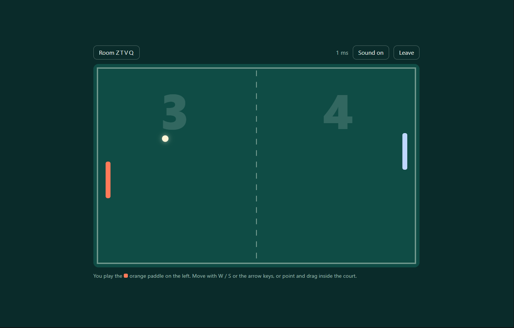

# Pong online

Real-time multiplayer Pong for two players, built with Node.js and WebSockets. The server owns the game, and each browser only sends input and draws what the server reports.


<p align="center">
  
</p>

<p align="center">
  <strong>Real-time multiplayer Pong built with Node.js and WebSockets.</strong>
</p>

## Features

- **Server-authoritative physics.** Ball, paddles and score are simulated on the server, so a client can't cheat by lying about positions.
- **Rooms.** Create a private room with a 4-letter code, share an invite link (`/?room=ABCD`), or use quick match to be paired with a random opponent.
- **Smooth netcode.** Fixed 60 Hz simulation, 30 snapshots per second, snapshot interpolation for the ball and the opponent, and client-side prediction for your own paddle.
- **Match flow.** First to 7 wins, rematch voting, and clean handling when a player leaves mid-game.
- **Playable anywhere.** Keyboard, mouse and touch controls, a responsive canvas, live ping display and sound effects.

## Requirements

- [Node.js](https://nodejs.org) 18 or newer

## Getting started

```bash
git clone https://github.com/ahmedosama2321/Pong-online.git
cd Pong-online
npm install
npm start
```

Open `http://localhost:3000` in two browser windows, create a room in one and join it from the other with the code.

To play across devices on the same network, open `http://<your-local-ip>:3000` on the second device. The server reads the port from the `PORT` environment variable:

```bash
PORT=8080 npm start          # macOS / Linux
$env:PORT=8080; npm start    # PowerShell
```

`npm run dev` restarts the server automatically when `server.js` changes.

## Controls

| Input | Action |
| --- | --- |
| `W` / `S` or `↑` / `↓` | Move your paddle |
| Mouse or touch | Move inside the court and the paddle follows |

Your paddle is always the orange one on the left, whichever side you play on. The client mirrors the court for the second player.

## Project structure

```
pong-online/
├── server.js          HTTP static server, WebSocket protocol, rooms, game loop
├── public/
│   └── index.html     Lobby, canvas renderer, input, netcode (no build step)
└── package.json
```

## How it works

### Server

- A single fixed-timestep loop (accumulator, 60 steps per second) advances every active room, independent of timer jitter.
- A snapshot goes to both players every second tick (30 Hz) and immediately on any phase change.
- Ball collision with paddles uses a swept test against the paddle face, so a fast ball can't tunnel through. The bounce angle depends on where the ball hits the paddle, and the ball speeds up with every hit up to a cap.
- Room phases: `waiting` → `countdown` → `playing` → `over`.
- Basic hardening: 1 KB max message size, per-connection rate limit, input validation, and a heartbeat that terminates dead connections.

### Client

- **Interpolation.** Remote state is rendered about 100 ms in the past, so there are normally two snapshots to blend. If snapshots run out, the ball is extrapolated for a short time.
- **Prediction.** Your own paddle moves immediately from local input. Small differences from the server are ignored while you move, the paddle eases onto the server position when idle, and it snaps if the drift is large.
- **Serve ids.** Each serve carries an id, so the client drops its interpolation history on a reset instead of sliding the ball across the court.

### Protocol

All messages are JSON.

| Client → server | Meaning |
| --- | --- |
| `{t:"create"}` | Create a room and join it |
| `{t:"join", code}` | Join a room by code |
| `{t:"quick"}` | Join the quick-match queue |
| `{t:"input", dir}` | Paddle direction: `-1` up, `0` idle, `1` down |
| `{t:"rematch"}` | Vote for a rematch after a game ends |
| `{t:"leave"}` | Leave the room or queue |
| `{t:"ping", ts}` | Latency probe |

| Server → client | Meaning |
| --- | --- |
| `joined` | You are in a room (`code`, `side`) |
| `queued` | You are waiting for a quick-match opponent |
| `s` | State snapshot: phase, countdown, ball `[x, y, vx, vy]`, paddles, score, sound events |
| `opponent_left` | The other player disconnected |
| `rematch_req` | Your opponent wants a rematch |
| `error` | Room not found, room full, and so on |
| `pong` | Reply to `ping` |

## Configuration

Gameplay constants are at the top of `server.js` (paddle size and speed, serve speed, speed-up per hit, win score, tick rate). The few values the client needs for prediction (`W`, `H`, `PW`, `PH`, `MARGIN`, `SPEED`) are repeated at the top of the script in `public/index.html`, so change them in both places.

## Ideas for next steps

- Input sequence numbers with replay on the client for exact reconciliation
- Simulated latency and packet loss for tuning the interpolation delay
- Reconnect to the same room after a dropped connection
- Bot opponent for solo practice
- Deployment on a Node host such as Render or Fly.io (WebSocket support required)
